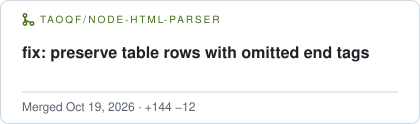
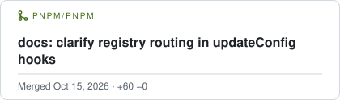
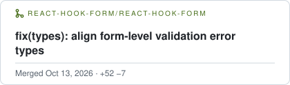
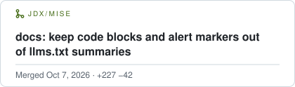

# 👋 Itamar Dahan

Full-stack and automation developer. I turn ideas into digital products that are simple to use and built to last, with thoughtful design, reliable development and a clear focus on your goals.

  
  
  
  

---

### 🧰 Languages and Tools

### 🤖 AI and Automation

#

### 🚀 Selected Systems

  <picture><source media="(prefers-color-scheme: dark)" srcset="assets/components/docknest-card.svg?v=green-original-20261009" /></picture>
  <a href="https://github.com/DahanItamar/Slotline"><picture><source media="(prefers-color-scheme: dark)" srcset="assets/components/slotline-card.svg?v=green-original-20261009" /></picture></a>

  <a href="https://github.com/DahanItamar/Winnow"><picture><source media="(prefers-color-scheme: dark)" srcset="assets/components/winnow-card.svg?v=green-original-20261009" /></picture></a>
  <a href="https://github.com/DahanItamar/HouseRules"><picture><source media="(prefers-color-scheme: dark)" srcset="assets/components/houserules-card.svg?v=green-original-20261009" /></picture></a>

#

### 🤝 Latest Open-Source Contributions

<!-- BEGIN OSS-PRS -->

  <a href="https://github.com/taoqf/node-html-parser/pull/322"><picture><source media="(prefers-color-scheme: dark)" srcset=".github/assets/oss/taoqf-node-html-parser-322-dark.svg" /></picture></a>
  <a href="https://github.com/pnpm/pnpm/pull/16762"><picture><source media="(prefers-color-scheme: dark)" srcset=".github/assets/oss/pnpm-pnpm-16762-dark.svg" /></picture></a>

  <a href="https://github.com/react-hook-form/react-hook-form/pull/13860"><picture><source media="(prefers-color-scheme: dark)" srcset=".github/assets/oss/react-hook-form-react-hook-form-13860-dark.svg" /></picture></a>
  <a href="https://github.com/jdx/mise/pull/14034"><picture><source media="(prefers-color-scheme: dark)" srcset=".github/assets/oss/jdx-mise-14034-dark.svg" /></picture></a>

<!-- END OSS-PRS -->

#

<picture>
  <source media="(prefers-color-scheme: dark)" srcset="https://raw.githubusercontent.com/DahanItamar/DahanItamar/output/pacman-contribution-graph-dark.svg" />
  
</picture>

